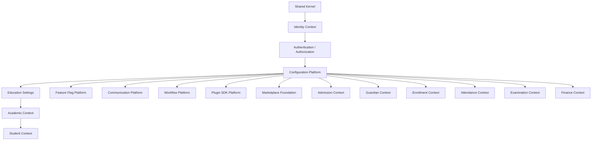

# Architecture Evolution Map

This document catalogs the dynamic changes and architectural evolution of the Nalentra Platform.

---

## 1. Bounded Context Additions

### Feature Flag Platform (P1-S08)
*   **Role:** Universal capability provider.
*   **Abstractions:** Provider-independent interface (`FeatureFlagProvider`) allowing seamless integration of third-party SaaS services.

### Communication Platform (P1-S09)
*   **Role:** Universal communications router.
*   **Abstractions:** Channel dispatcher abstraction (`CommunicationDispatcher`) and matching provider contracts (`CommunicationProvider`).

### Workflow Platform (P1-S10)
*   **Role:** Universal process orchestrator.
*   **Abstractions:** Decoupled `WorkflowEngine` and `WorkflowResolver` matching state paths.

### Plugin SDK Platform (P1-S11)
*   **Role:** Universal modular extensions framework.
*   **Abstractions:** Unified `PluginRegistry` discovery index and `PluginEngine` lifecycle transitions controller.

### Marketplace Foundation (P1-S12)
*   **Role:** Platform capabilities distribution network.
*   **Abstractions:** `MarketplaceRegistry` catalog discoverability and `MarketplaceInstaller` compatibility validator checks.

### Admission Management (P2-S01)
*   **Role:** First education vertical capability context.
*   **Abstractions:** `AdmissionEngine` state validation transitions orchestrator.

### Guardian Management (P2-S02)
*   **Role:** Independent master guardian catalog context.
*   **Abstractions:** `GuardianEngine` verification and activation workflow manager.

### Enrollment Management (P2-S03)
*   **Role:** Independent student enrollment relationship bounded context.
*   **Abstractions:** `EnrollmentEngine` promotion, transfer, and activation manager.

### Attendance Management (P2-S04)
*   **Role:** Student attendance tracking context.
*   **Abstractions:** `AttendanceEngine` sheet validation, publishing, and reopening manager.

### Examination Management (P2-S05)
*   **Role:** Student academic examination and grading context.
*   **Abstractions:** `ExaminationEngine` assessment validation, grade calculation, and results publishing manager.

### Finance Management (P2-S06)
*   **Role:** Student accounting and billing context.
*   **Abstractions:** `FinanceEngine` tuition fees sum calculation, billing invoice generation, and payment registration manager.

---

## 2. Refactorings & Service Decomposition

### Academic Service Split (CTO-024)
*   Decomposed large service implementations into highly cohesive sub-services orchestrated behind a unified Facade interface.
*   Preserves controller API boundaries.
